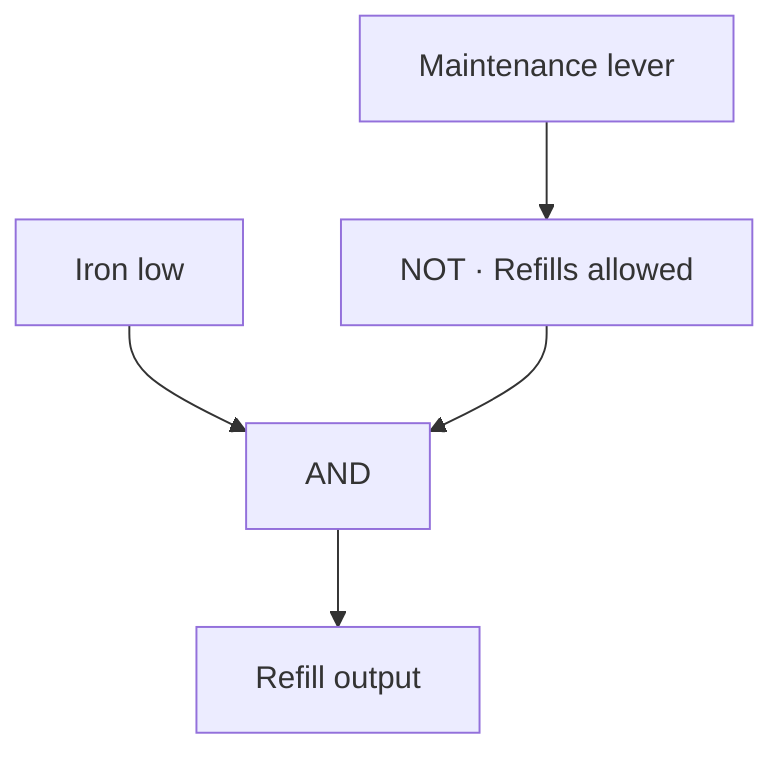

# Logic Sandbox

Create a circuit and use **+ Add** to add nodes. Rename nodes so you can recognize them in the source picker. On each gate or Output, tap **A** or **B** and select the node that feeds it. Configure the redstone route on each Input or Output. When the circuit is ready, use **Menu → Enable circuit**.

| Node | Signal |
| --- | --- |
| Input | The selected digital or bundled redstone input |
| Item amount | Whether the selected ME item count meets a comparison |
| AND | Both sources are on |
| OR | At least one source is on |
| NOT | The opposite of A |
| XOR | Exactly one source is on |
| Output | Sends A to the selected redstone route |

Enabled circuits show **1** for on, **0** for off and **?** for unknown. **Popup ON** raises an alert when that node becomes true. Acknowledge the popup to clear the alert. The node needs to go false before another true signal raises the next alert.

## Item amount

1. Choose **+ Add → Item amount → Set item count**.
2. Select an AE sensor client, its card side and the target on the ME network you want to read.
3. Choose an item. Use **Find** to search by item name or RawName. For an item that has yet to arrive, use **Find → Manual item** and enter its RawName and damage value.
4. Select **Under**, **Over** or **Exactly**, enter the level, and **Save**.
5. Choose that node as a source for a gate or Output. Enable the circuit.

Under 64 is true at 63 and false at 64. A complete inventory with the item absent gives a count of zero. An offline or unpowered ME system gives **?**. A NOT gate keeps an unknown input unknown, and an Output with an unknown result goes off. Enabled circuits run with their windows closed and resume from saved configuration after restart.

Use **Level Emitter** for quick standalone stock alarms with pulse timing, hold and rearm settings. Use the **Item amount** node when a stock condition needs to interact with other signals.

## Example circuits

### Door-open lamp

The door contact reads on when the door is shut. Set the NOT gate's **A** to **Door contact**. Set the lamp Output's **A** to **Door open**, the name of that NOT gate. The lamp lights when the contact goes low.

### Refill with a maintenance override

Set **Iron low** to Item amount → Iron Ingots → Under 512. Route the **Maintenance** Input to a lever that is on during maintenance. Set the NOT gate's **A** to Maintenance. Feed **Iron low** into **A** of an AND gate and **Refills allowed** into **B**. Feed that AND gate into the refill Output.

### More flows

| Goal | Set up |
| --- | --- |
| Alert when either material runs low | Put two Item amount nodes into an OR gate. Enable **Popup ON** on the OR gate. |
| Detect whether two levers disagree | Put the two redstone Inputs into an XOR gate. Feed the XOR gate to an indicator Output. |
| Signal that a buffer is empty | Set an Item amount node to **Exactly 0**. Connect it directly to the Output. |
