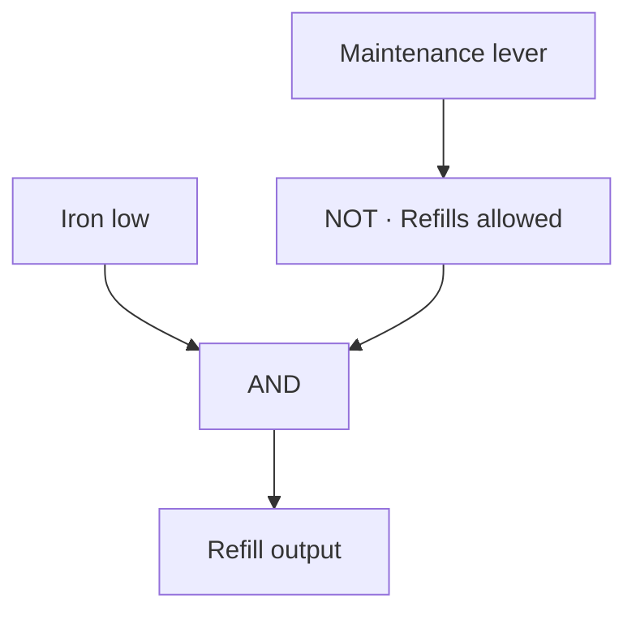

# Logic Sandbox

Create a circuit and use **+ Add** to add nodes. Rename nodes so you can recognize them in the source picker. On each gate or Output, tap **A** or **B** and select the node that feeds it. Configure the redstone route on each Input or Output. When the circuit is ready, use **Menu → Enable circuit**.

| Node | Signal |
| --- | --- |
| Input | The selected digital or bundled redstone input |
| Item amount | Whether the selected ME item count meets a comparison |
| AND | Both sources are on |
| OR | At least one source is on |
| NOT | The opposite of A |
| XOR | Exactly one source is on |
| Delay | Turns on after its source stays on for the configured time |
| If / Then | Runs its selected action blocks in order when the condition goes on |
| Output | Sends A to the selected redstone route |
| Output target | A named redstone destination that Set output blocks can reuse |
| Wait | Pauses a rule for the configured time |
| Set output | Sends ON or OFF to its selected output target |
| Alarm | Shows a popup with the name of the alarm block |

Enabled circuits show **1** for on, **0** for off and **?** for unknown. **Popup ON** raises an alert when that node becomes true. Acknowledge the popup to clear the alert. The node needs to go false before another true signal raises the next alert.

## Item amount

1. Choose **+ Add → Item amount → Set item count**.
2. Select an AE sensor client, its card side and the target on the ME network you want to read.
3. Choose an item. Use **Find** to search by item name or RawName. For an item that has yet to arrive, use **Find → Manual item** and enter its RawName and damage value.
4. Select **Under**, **Over** or **Exactly**, enter the level, and **Save**.
5. Choose that node as a source for a gate or Output. Enable the circuit.

Under 64 is true at 63 and false at 64. A complete inventory with the item absent gives a count of zero. An offline or unpowered ME system gives **?**. A NOT gate keeps an unknown input unknown, and an Output with an unknown result goes off. Enabled circuits run with their windows closed and resume from saved configuration after restart.

Use **Level Emitter** for quick standalone stock alarms with pulse timing, hold and rearm settings. Use the **Item amount** node when a stock condition needs to interact with other signals.

## Timing

Add **Delay** and select the source under **When**. Set **Wait** in seconds. A low signal cancels the wait and turns the result off. An unknown signal cancels the wait and gives an unknown result. Tap **+ Link output** to route the delayed result.

Add **If / Then** for ordered actions. Pick the condition under **When**, open **Then blocks**, and tap **+ Block**. Create a **Wait**, **Set output**, or **Alarm** block, or choose an existing one by name. A block can appear in multiple rules or multiple positions in one rule. Tap a block in the list to edit it, move it, or remove that occurrence.

Each **Set output** block chooses its own target and ON or OFF value. Use **+ New target** the first time you configure a route. Pick that same target from other Set output blocks to act on the same wire. The target keeps the last commanded state until another block changes it or you disable the circuit.

A rule runs once when its condition becomes true and finishes even if the condition falls during the run. A fresh low then high starts another run after completion. The If / Then node itself reads on while its blocks are still running. An Alarm block can run with an output either on or off.

Waits accept seconds with up to two decimal places. The OS starts timing when it observes the source or reaches the Wait block. Delays round up to a game tick, and physical redstone writes also follow the IO client's cooldown. Enabled circuits run with their windows closed. After an OS restart, timing starts fresh from the observed inputs and saved blocks.

Tap **Flow** on the circuit screen to read the assembled rule. On narrow windows, open **Menu → View flow**.

## Example circuits

### Door-open lamp

The door contact reads on when the door is shut. Set the NOT gate's **A** to **Door contact**. Set the lamp Output's **A** to **Door open**, the name of that NOT gate. The lamp lights when the contact goes low.

### Refill with a maintenance override

Set **Iron low** to Item amount → Iron Ingots → Under 512. Route the **Maintenance** Input to a lever that is on during maintenance. Set the NOT gate's **A** to Maintenance. Feed **Iron low** into **A** of an AND gate and **Refills allowed** into **B**. Feed that AND gate into the refill Output.

### More flows

| Goal | Set up |
| --- | --- |
| Alert when either material runs low | Put two Item amount nodes into an OR gate. Enable **Popup ON** on the OR gate. |
| Detect whether two levers disagree | Put the two redstone Inputs into an XOR gate. Feed the XOR gate to an indicator Output. |
| Signal that a buffer is empty | Set an Item amount node to **Exactly 0**. Connect it directly to the Output. |

### Turn on for 20 seconds, then alarm

1. Feed **Input 2** and **Input 3** into an AND gate.
2. Feed **Input 1** and the AND gate into an OR gate.
3. Add an **If / Then** rule whose **When** source is the OR gate. Add these blocks in order.

   | Position | Block |
   | --- | --- |
   | 1 | Wait 0.5 s |
   | 2 | Set a target ON |
   | 3 | Wait 20 s |
   | 4 | Set the same target OFF |
   | 5 | Alarm |

4. Open **Flow** to verify the grouping, then use **Menu → Enable circuit**.

An item comparison can feed either gate like a redstone input. Add a NOT node where the rule should use the opposite of a signal.
